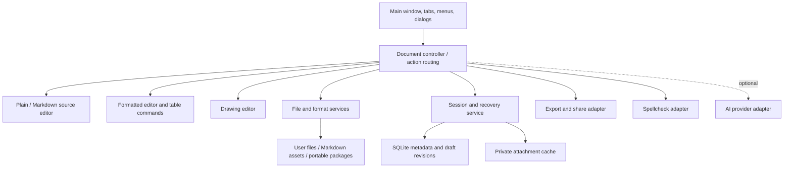

# Fedora KDE Notepad — project plan

**Prepared:** 18 October 2026  
**Status:** Native development implementation available. See [implementation status](docs/status.md) and [the Qt binding decision](docs/decisions/001-native-qt-bindings.md) for delivered scope, stack changes, and outstanding release gates.  
**Target:** Fedora KDE 44, x86_64, Plasma Wayland first.  
**Working name:** Notepad; choose a distinct public name and application ID before distribution.

## 1. Product decision

Build a standalone native desktop application with the simplicity of Windows Notepad and the requested additions: editable tables, inline images, drawing, persistent unnamed drafts, and portable sharing.

This is a lightweight document and notes editor. It is not a Microsoft Word replacement: continuous scrolling is the primary editing experience, with pagination only for printing/PDF. DOCX compatibility, spreadsheet calculations, and advanced publishing layout are outside the initial scope.

Keep KWrite installed and unchanged. Reusing its source would tie the product to a text editor architecture that does not directly provide the requested visual document editing.

### What “all Windows Notepad features” means

Use an explicit feature checklist rather than promise parity with an unspecified, changing Windows release. The baseline below combines documented Notepad behavior and conventional text editor functions. Microsoft announcements establish that a feature exists, not that it is available in every stable installation.

Before declaring parity, record a reference Windows Notepad version and manually compare behavior where access is available. Until then, mark detailed shortcut/menu equivalence as unverified. No Windows installation was operated during this research.

Core Notepad parity is required for the first stable release. AI equivalents are a separately delivered phase because they require an inference provider. Images and drawing are project requirements regardless of Windows availability; image support in current Notepad has not been established by the official sources reviewed here.

## 2. Goals and completion criteria

The user should be able to:

1. Install the app once and launch it from KDE's application menu, search, or a pinned taskbar icon.
2. Open files from Dolphin and use multiple tabs/windows.
3. Start a note without naming it; close the window and recover the draft after reopening or rebooting.
4. Use Save, Save As, Save All, and Export with clearly different behavior.
5. Edit ordinary text without unwanted formatting or encoding changes.
6. Create and visually edit Markdown-compatible documents, tables, images, and drawings.
7. Add/remove table rows and columns through visible controls and context menus.
8. Export `.txt`, `.md`, PDF, and a portable note file, understanding any conversion losses.
9. Share a document together with its attachments.
10. Continue using the installed app after normal kernel updates without rebuilding it or running commands.

The application must prioritize reliable saving and recovery over extra toolbar features.

## 3. Feature inventory and release scope

Phases are defined in section 16. “Core” means required before v1.0, not necessarily in the first prototype. “Extended” means additional requested functionality, also required before calling the user's requested solution complete.

| ID | Capability | Requirement / behavior | Delivery |
| --- | --- | --- | --- |
| F01 | File lifecycle | New note/tab/window, Open, Open Recent, Save, Save As, Save All, close tab/window, exit | Core: P1–P2 |
| F02 | Tabs | Rename untitled drafts, reorder tabs, duplicate, close others/right, reopen closed tab, move to another window | Core: P1–P2 |
| F03 | Session restoration | Restore windows, tab order, named and unnamed content, cursor/selection, zoom, and scroll position | Core: P2 |
| F04 | Editing | Undo/redo, cut/copy/paste, plain-text paste, delete, select all | Core: P1 |
| F05 | Search | Find, next/previous, replace, replace all, case/whole-word options, wrap-around, selected-text scope | Core: P1 |
| F06 | Navigation | Go to line, source line/column, keyboard navigation, clickable links with confirmation where appropriate | Core: P1/P3 |
| F07 | Text utilities | Insert date/time; optional `.LOG` timestamp-on-open compatibility; indentation/tab width | Core: P1/P6 |
| F08 | View/settings | Word wrap, zoom/reset, font family/size, system/light/dark theme, status bar, formatting toggle | Core: P1/P3 |
| F09 | Status | Line/column in source mode, word and character/selection counts, encoding, line endings, modified/recovery state | Core: P1–P3 |
| F10 | Text formats | UTF-8 default, UTF-8 BOM and UTF-16 LE/BE, LF/CRLF/CR detection and explicit conversion | Core: P1 |
| F11 | Print | Print, preview, page size/orientation/margins, headers/footers, page numbers; PDF export | Core: P6 |
| F12 | Writing assistance | Multilingual spellcheck, suggestions, ignore/add dictionary, language selection, optional autocorrect | Core: P6 |
| F13 | Markdown formatting | Headings, bold, italic, strikethrough, links, lists, nested lists, quotes, inline/fenced code, clear formatting | Core: P3 |
| F14 | Editing modes | Plain text; Markdown source; formatted view/editing; optional split source/preview | Core: P3 |
| F15 | Tables | Exact-size blank table grid/numeric insertion; no automatic header labels; insert/delete/duplicate/move rows and columns; drag/numeric column widths and row minimum heights; alignment, equal sizing and content fitting | Core: P4 |
| F16 | Images | Insert from file/paste/drop; alt text; aspect-preserving resize; replace/remove; managed attachments | Extended: P5 |
| F17 | Drawing | Pen/highlighter/eraser, colors/width, undo/redo, basic shapes, reopen/edit drawing; mouse and pen support | Extended: P5 |
| F18 | Export/share | Text, Markdown + assets, PDF, portable note; ZIP share bundle; available desktop sharing targets | Extended: P5–P6 |
| F19 | Desktop integration | Launcher, correct taskbar grouping, Dolphin Open With, file arguments, native dialogs, HiDPI/Wayland | Core: P1/P7 |
| F20 | Document safety | Atomic saving, recovery, disk-full handling, permission errors, external-edit conflict detection | Core: P1–P2 |
| F21 | Preferences/privacy | Startup/close behavior, recents toggle/clear, dictionaries, recovery management, shortcuts | Core: P2/P6 |
| F22 | Help/discovery | About, shortcuts help, optional What's New, troubleshooting; no blocking onboarding | Core: P6 |
| F23 | AI equivalents | Write, Rewrite, Summarize; streamed preview, accept/reject, cancellation, one-step undo | Parity extension: P8 |
| F24 | Quality-of-life extras | Task lists, optional line numbers, focus mode, regex find if justified | Extras after core foundation |

Documented Microsoft references: [formatting][ms-format], [tables][ms-tables], [spelling/autocorrect][ms-spelling], [recent files and summaries][ms-recents], [strikethrough, nested lists, and streaming AI][ms-2026]. Their documented interaction principles inform this inventory; Linux-specific behavior is designed separately.

### Scope boundaries

- No account, cloud service, background daemon, or network connection is required for ordinary notes.
- Microsoft Copilot services, Microsoft sign-in, and its subscription benefits cannot simply be copied into this app. Provide optional equivalent actions through a supported provider later.
- No built-in cloud sync or collaborative editing in v1. Files may live in a user-managed synced directory, with conflict handling.
- No DOCX/ODT import/export in v1. This project does not produce Office document compatibility by saving a file under a different extension.
- No OCR, spreadsheets/formulas, browser embedding, plugin marketplace, or system-wide default-editor changes in v1.
- Preserve keyboard accessibility and ordinary text workflows while visual features are enabled.

## 4. Recommended technology stack

| Layer | Selection | Reason |
| --- | --- | --- |
| Language | C++20 | Direct Qt/KDE APIs, explicit ownership, straightforward native distribution |
| UI | Qt 6 Widgets | Mature menus, tabs, dialogs, printing, and editable rich text |
| Application shell | `QApplication`, `QMainWindow`, `QTabWidget`, shared `QAction` registry | Conventional desktop behavior and consistent shortcuts |
| Plain/source editor | `QPlainTextEdit` + optional `QSyntaxHighlighter` | Exact text editing, line navigation, separate source behavior |
| Formatted editor | `QTextEdit`, `QTextDocument`, `QTextCursor`, `QTextTable` | Existing support for editable formatting, images, lists, and tables |
| Drawing | Custom QWidget canvas using `QPainter`, tablet/pointer events, `QUndoStack` | Native drawing without requiring a browser engine |
| Local services | C++ service classes inside the application process | A local backend; no HTTP server or hosted infrastructure |
| File I/O | `QFile`, `QSaveFile`, `QFileSystemWatcher`, `QCryptographicHash` | Reliable writes and external-change detection |
| Draft database | Qt SQL SQLite driver (`QSQLITE`) | Transactional session/draft metadata and recoverable revisions |
| Settings/paths | `QSettings`, `QStandardPaths` | Respect platform locations and Flatpak isolation |
| Portable package | ZIP via libarchive + JSON manifest + Markdown + assets | Versioned, inspectable, single-file sharing |
| Spelling | KDE Sonnet with packaged dictionary backend/dictionaries | Native suggestions; validate editor attachment in P0 |
| Desktop sharing | KDE Purpose where supported; export/Open Containing Folder fallback | Sharing availability depends on installed providers and sandbox permissions |
| Printing/PDF | Qt PrintSupport and Qt PDF output APIs | Native print workflow and document export |
| Build | CMake + Ninja, Extra CMake Modules where required | Standard C++/Qt/KDE tooling |
| Tests | Qt Test + CTest, temporary directories and fault-injection interfaces | Exercise data safety and editor operations |
| Packaging | Flatpak with a maintained KDE runtime/SDK | Desktop integration and dependencies independent of host development packages |
| Secondary packaging | Fedora RPM after the Flatpak release is reliable | Optional native distribution channel |

### Version and dependency policy

- Start with Qt >= 6.8 as the proposed minimum, then verify every used API against the selected runtime in P0. The development host has Qt 6.11.2; do not accidentally require host-only APIs.
- Select an actively supported KDE Flatpak runtime branch whose Qt and Frameworks versions satisfy the application. Pin that branch and third-party archive checksums in the manifest. The exact branch is a P0 result, not a guessed value in this plan.
- Build release artifacts against that SDK; do not compile on the host and copy an incompatible executable into Flatpak.
- Package the Qt Wayland/platform plugins, image codecs, SQLite plugin, Sonnet backend, and required dictionaries/translations.
- Keep the application core independent of desktop sharing and AI providers, so missing optional integrations do not prevent launch.
- Use existing Qt Markdown support initially. A separate parser/source mapping layer is a deliberate fallback if the fidelity spike fails, not an immediate additional dependency.

Qt documents support for rich-text editing and Markdown conversion, including conversion limitations. That makes it a good starting point, but does not establish lossless Markdown round trips. [QTextEdit][qt-edit], [QTextDocument][qt-document], [QTextTable][qt-table].

### Why this stack

Qt Widgets provides the desktop controls and text editing primitives this app needs directly. C++ adds implementation effort but avoids operating a second language runtime. QML/Kirigami remains an option for a future touch-oriented redesign; it does not solve Markdown fidelity automatically. An Electron/web frontend would add a browser runtime to this small desktop tool. These are project tradeoffs, not claims that those alternatives cannot work.

## 5. UI and interaction design

### Main window

Use KDE fonts, icon theme, palette, spacing, standard window decorations, and dialogs. Follow the system theme initially. Do not copy Windows branding or require a custom title bar.

```text
┌──────────────────────────────────────────────────────────────────────────┐
│ Notepad — Project notes                                      _  □  ×    │
├──────────────────────────────────────────────────────────────────────────┤
│ [Untitled 1 • ×] [Project notes.md ×] [Sketch.note • ×]   [+]             │
├──────────────────────────────────────────────────────────────────────────┤
│ File  Edit  View  Insert  Format  Tools  Help                  Settings   │
│ [Paragraph ▾] [B] [I] [S] [List ▾] [Link] [Table ▾] [Image] [Draw]       │
├──────────────────────────────────────────────────────────────────────────┤
│                                                                          │
│   Project notes                                                          │
│                                                                          │
│   A continuous, uncluttered editing area.                                 │
│                                                                          │
│   ┌─────────────────────┬────────────────────┐                           │
│   │ Task                │ Status             │                           │
│   ├─────────────────────┼────────────────────┤                           │
│   │ Build editor        │ In progress        │                           │
│   └─────────────────────┴────────────────────┘                           │
│                                                                          │
│   [inline image or drawing]                                              │
│                                                                          │
├──────────────────────────────────────────────────────────────────────────┤
│ Draft protected · Unsaved file    124 words   100%   [Formatted | Source] │
└──────────────────────────────────────────────────────────────────────────┘
```

This is a conceptual wireframe. Actual dimensions and spacing must be checked at 100%, 150%, and 200% scaling. Start around 1000 × 720 logical pixels, fit smaller screens, and persist window geometry without restoring it off-screen.

- Start with one empty tab and immediate typing focus. Restore a prior session if enabled.
- Hide formatting controls in plain-text mode. Keep file actions and search accessible through menus/shortcuts.
- Use a normal title bar and approximately 32–40 logical pixel toolbar controls, adjusted by platform style and accessibility settings.
- Show a modified dot independently from draft protection: a protected draft can still contain unsaved file changes.
- Show source line/column only where meaningful. In formatted view show words/characters and selection counts; never invent source coordinates from visual wrapping.
- Show operation errors in a persistent banner with retry/details. Do not use a transient toast as the only indication of save failure.
- An optional split view has editable source and a read-only formatted preview. It is not two independently editable copies.
- Overflow toolbar items on narrow windows; keep menu actions available.

### Menus

| Menu | Main actions |
| --- | --- |
| File | New Tab, New Window, Open, Recent Files, Save, Save As, Save All, Export, Share, Page Setup, Print, Close Tab, Exit |
| Edit | Undo/Redo, Cut/Copy/Paste, Paste Plain Text, Delete, Select All, Find/Replace, Go to Line, Insert Date/Time |
| View | Plain/Source/Formatted/Split where applicable, Wrap, Zoom, Status Bar, optional Line Numbers, Focus Mode |
| Insert | Table, Image, Drawing, Link, Code Block, optional Task List |
| Format | Heading/paragraph, emphasis, lists/indentation, quote, code, clear formatting |
| Tools | Spelling, language, preferences; optional AI actions after configuration |
| Help | Shortcuts, What's New, About, troubleshooting/export diagnostics |

### Proposed default shortcuts

Use platform standard key bindings through `QKeySequence::StandardKey` when available. Test for conflicts; do not assume exact Windows shortcuts suit KDE.

| Action | Proposed shortcut |
| --- | --- |
| New tab / window | Ctrl+N / Ctrl+Shift+N |
| Open / Save / Save As / Save All | Ctrl+O / Ctrl+S / Ctrl+Shift+S / Ctrl+Alt+S |
| Close / reopen tab | Ctrl+W / Ctrl+Shift+T |
| Next / previous tab | Ctrl+Tab / Ctrl+Shift+Tab |
| Undo / redo | Ctrl+Z / platform standard redo |
| Find / Replace / Go to line | Ctrl+F / Ctrl+H / Ctrl+G |
| Find next / previous | F3 / Shift+F3 |
| Insert date/time | F5 |
| Print | Ctrl+P |
| Bold / italic / link | Ctrl+B / Ctrl+I / Ctrl+K in formatted mode |
| Paste plain text | Ctrl+Shift+V |
| Zoom in/out/reset | Ctrl++ / Ctrl+- / Ctrl+0 |
| Context menu | Shift+F10 |

### Accessibility and international input

- Every action must be reachable by keyboard, with focus order, accessible names, and non-color-only state indicators.
- Test screen reader navigation, large fonts, high contrast, and a table's row/column context.
- Test Hindi/Devanagari IME composition, Latin text, emoji, combining marks, bidirectional text, and right-to-left paragraphs.
- Define character counts as Unicode code points, excluding encoding BOM; optionally show user-perceived characters separately. Source line/column behavior must be documented and tested with surrogate pairs/tabs.
- Use translatable strings from the beginning. English is the first supported UI language.

## 6. Document formats and conversion rules

### Format capabilities

| Format | Text | Tables | Images | Re-edit drawing strokes | Single file |
| --- | --- | --- | --- | --- | --- |
| `.txt` | Exact source text | ASCII/tab-separated representation | Text reference/description only | No | Yes |
| `.md` + assets | Markdown source | GitHub-style Markdown tables | Relative image references | Only if companion project data is retained | Only without attachments |
| `.note` working extension | Markdown subset + manifest | Supported table model | Bundled images | Yes, drawing JSON + rendered image | Yes |
| `.zip` Markdown share bundle | Markdown + assets | Markdown tables | Bundled files | Optional project data | Yes, archive must be extracted |
| `.pdf` | Rendered document | Rendered tables | Rendered images/drawings | No | Yes |

`.note` is a provisional custom ZIP-based format, not an existing interoperability standard. Check extension/MIME collisions before release. A plain Markdown file is still a text file and cannot inherently contain external image bytes or editable drawing strokes.

### Default behavior

- New note starts as an unnamed plain-text draft. Applying formatting or inserting rich content offers a switch to a document mode; do not silently change an existing `.txt` file's format.
- First Save defaults to `.txt` for plain text, `.md` for supported formatted text/tables, and the portable format when editable drawing data or bundled images are present. Other choices remain visible.
- Markdown containing only supported elements is an interoperability target, not a promise of complete GitHub-flavored Markdown or arbitrary HTML support.
- Opening arbitrary Markdown retains its original bytes/source. Merely viewing a preview, switching views without edits, or saving an untouched file must not rewrite it.
- Source edits preserve unedited markup rather than round-tripping the entire file through `toMarkdown()`.
- Before the first formatted edit of imported Markdown, explain that formatting may normalize supported markup. If unsupported constructs are detected or fidelity is uncertain, keep the original source editable with read-only preview and offer **Create Formatted Copy** using a new destination.
- Never silently discard front matter, HTML, reference definitions, unknown extensions, or unsupported table content.
- Save to `.txt` from a rich document shows a conversion preview, keeps text/table cell contents, and replaces images/drawings with explicit descriptions or references. The original rich document remains open unless the user explicitly chooses format conversion.
- Export creates another artifact and does not change the document's save target or mark its outstanding edits saved.
- Save As changes the document identity only after the complete write succeeds. On failure, keep the old identity and unsaved state.

### Markdown fidelity gate

P0 must test imports/exports with tables containing pipes/backslashes, empty cells, nested lists, code fences, links, images, Unicode, front matter, reference links, raw HTML, and unsupported syntax. Do not infer safe conversion solely because Qt renders something plausible.

Use a declared supported-feature profile and compare text, structure, and attachments on reload. If a file cannot be proven compatible with formatted editing, use source editing plus preview. If Qt cannot preserve the supported profile, investigate a source-aware parser/document layer before promising full visual editing; that increases the schedule. Do not ship destructive conversion as a shortcut.

## 7. Table, image, and drawing behavior

### Tables

- Offer a small grid picker plus **Custom Size** with total row and column counts. Per the revised user requirement, insert exactly those blank cells, with no extra header row or generated “Column 1” labels.
- Initial limit: 100 columns and 1,000 total rows, also capped at 20,000 cells. Validate before allocating; reassess after profiling.
- Contextual commands: row above/below, column left/right, delete row/column, delete table, and align column left/center/right.
- A dimensions dialog changes counts. Reducing dimensions previews how many nonempty cells will be removed and requires an explicit Apply action; undo restores them.
- Keep a rectangular grid. No merged/nested tables in the Markdown profile. Imported complex tables stay source-only or require an explicit converted copy.
- Tab/Shift+Tab move between cells; Tab in the last cell may append a body row as one undoable operation. Provide a documented way to leave the table.
- Support selected-cell text copy and tabular paste where dimensions can be inferred. Escape Markdown pipes and preserve literal code/text correctly.
- Column widths and row minimum heights are persisted in the native format and support numeric input, border dragging, equal sizing, and content fitting. Rows grow to fit content. Display dimensions are native-format metadata. Explain that plain Markdown does not preserve exact pixel widths, fonts, or borders.

### Images

- Insert from file picker, clipboard, or drag/drop. Decode by file content; do not trust only the extension.
- Start with PNG, JPEG, and WebP. Treat imported SVG as deferred until rendering/resource restrictions are tested.
- Copy imported bytes into managed attachment storage using stable identifiers. Do not depend permanently on the source photo remaining in its original location.
- Provide alt text, proportional resize, original size, replace, remove, and Open Containing Folder where a real exported asset exists.
- Exact display size belongs in the native manifest. Markdown export uses ordinary image references and warns if size metadata cannot be represented.
- Show a missing-image placeholder with a repair action. Deleting an image from one revision must not immediately delete bytes needed for undo/recovery.
- Reject unreasonable decoded dimensions/size with an actionable message; initial cap 50 megapixels / 25 MiB compressed per image, tuned after measurement.
- Do not automatically fetch remote images when opening a document. Offer explicit loading only if that feature is later implemented.

### Drawing

- Open a focused drawing dialog/canvas from Insert > Drawing; keep the note itself a document editor.
- First delivery: freehand pen, highlighter, stroke eraser, color/width controls, undo/redo, clear with confirmation, zoom, mouse/stylus input.
- Follow with straight lines, rectangles, ellipses, and arrows before v1.0 if they pass export/recovery tests. Selection/moving shapes can follow as an enhancement.
- Persist drawing objects as versioned JSON with normalized coordinates and optional pressure. Store a PNG preview for document display and interoperability.
- Double-click/reopen an owned drawing to edit its objects; ordinary pasted screenshots remain images.
- Cancel leaves the note unchanged. Insert/update commits one undoable document action; drawing-local undo history need not survive closing the drawing dialog.
- Native files retain strokes. Standard Markdown exports the rendered image; offer companion project data or the native file when editable drawings must travel with it.

## 8. Architecture and local backend

The backend is a set of local services inside the executable. No REST API, web server, authentication database, or separate service process is needed.



### Main modules

| Module | Responsibility |
| --- | --- |
| `ApplicationController` | Startup, open-file arguments, window registry, shutdown, second-launch routing |
| `DocumentSession` | Stable UUID, format/path, active representation, dirty state, revision, encoding/EOL, attachment references |
| `DocumentController` | Save decisions, command dispatch, conversions, conflict handling; no direct widget-specific persistence |
| `PlainTextEditor` | Plain/source editing, source selection and cursor semantics, search integration |
| `FormattedEditor` | Supported formatting and table/image commands with explicit serialization boundaries |
| `FormatService` | Text codecs, Markdown import/export, supported-feature assessment, loss/conversion report |
| `FileService` | Atomic saves, target access, conflict checks, asset-first Markdown writes |
| `AttachmentStore` | Stable IDs, checksums, managed import, reference tracking, delayed collection |
| `PackageService` | Bounded ZIP read/write, manifest/schema validation, path restrictions |
| `RecoveryService` | Scheduled snapshots, revisions, restore, retention, error reporting |
| `SessionService` | Window/tab layout, restored identities, recent files, close/reopen policy |
| `DrawingService` | Drawing model, rendering, version migrations |
| `ExportService` | TXT/Markdown/native/PDF and ZIP production without retargeting current file |
| `ShareService` | Prepared artifact handoff to available targets; never automatic sending |
| `SettingsService` | Preferences, migration, settings UI binding |
| `SpellcheckService` | Language/backend management, suggestions, dictionary persistence |
| `AiService` | Optional provider connection, cancellable generation, preview and accept/reject |

### Editor state and undo

- A session has one active editable representation; preview widgets are projections.
- Exact source bytes and the last saved revision are tracked separately from formatted projections.
- Normal typing uses the editor's native undo facilities. Group structured actions, including table resize and accepted AI text, as single operations.
- Do not reset `QTextDocument` on each keystroke or call `setMarkdown()` on the active editor for every preview update; Qt documents that loading Markdown resets its undo history.
- Mode conversion is a document command with before/after content, attachment references, dirty state, and cursor bookmarks. Keep inactive editor history while unchanged; a conversion must remain undoable even if a reconstructed widget loses its local stack.
- P0 must demonstrate editing → mode switch → edit → undo/redo without lost text or stale attachments. If maintaining a coherent history requires an application command stack, implement that before exposing both editable modes. Do not expose two editors with inconsistent histories.
- Undo history persistence across process restarts is not promised in v1; restored content and its unsaved state are promised.

### Concurrency

- All QWidget/QTextDocument interaction remains on the GUI thread.
- Workers receive immutable snapshots for encoding, hashing, archive work, and database persistence. Create/use each SQLite connection in its owning thread.
- Every async operation carries session UUID and revision. A completed save of revision N does not clear changes made at revision N+1.
- Debounce preview updates around 150–250 ms. Cancel/ignore stale results, and bound queued snapshots.
- Add progress/cancellation for large operations; never make normal typing wait for archive generation or sharing.

## 9. Data layout and portable format

Use `QStandardPaths` rather than hardcoded home directories. Flatpak maps application data/settings under `~/.var/app/<app-id>/`; development and RPM installations use the appropriate XDG locations.

```text
application-data/
  state.sqlite                 # draft revisions, sessions, recents, attachment references
  assets/<content-hash>         # private imported bytes and drawing previews
  staging/<operation-id>/       # incomplete imports/exports; removable after recovery audit
application-config/
  settings                     # QSettings-managed preferences
application-cache/
  thumbnails/                  # rebuildable; never the only copy of unsaved content
```

Draft database concepts:

- `documents`: UUID, path/access locator, kind, current/saved revision, encoding, EOL profile, fingerprint.
- `draft_revisions`: document UUID, revision, source/body snapshot, native metadata, timestamp, checksum.
- `assets`: hash/ID, MIME, size, private storage location.
- `revision_assets`: revision-to-asset references, committed with the revision transaction.
- `windows` / `tabs`: session geometry, order, view mode and cursor bookmarks.
- `recent_files`: bounded opt-out history; removed independently from draft content.
- `schema_version`: explicit forward migration; backup before destructive migration.

Write immutable asset bytes and verify them before committing a database revision that references them. On startup reconcile orphaned staging/assets conservatively; never collect files still referenced by recovery revisions or active undo history.

### Portable package example

```text
Meeting.note                   # ZIP container
  manifest.json
  content.md
  assets/<id>.png
  drawings/<id>.json
  previews/<id>.png
```

The manifest records `schemaVersion`, document UUID/title, content path, supported Markdown profile, asset IDs/paths/MIME/checksums, image display metadata, and drawing-to-preview relationships. No machine-specific absolute paths.

Example draft schema, to finalize in P0/P5:

```json
{
  "schemaVersion": 1,
  "documentId": "uuid",
  "title": "Meeting",
  "content": "content.md",
  "profile": "notepad-markdown-v1",
  "assets": [
    {
      "id": "drawing-uuid",
      "path": "previews/drawing-uuid.png",
      "mime": "image/png",
      "sha256": "hex-digest",
      "drawing": "drawings/drawing-uuid.json"
    }
  ]
}
```

Treat future unsupported schema versions as read-only where safe, or explain that an upgrade is required. Never overwrite a package with a schema we cannot understand.

## 10. Saving, drafts, closing, and recovery

### Separate states

| State | Meaning | UI |
| --- | --- | --- |
| Unnamed, modified, protected | Draft persisted internally, no user file exists | “Draft protected · Unsaved file” |
| Named, clean | Current revision matches the successfully saved user file | “Saved” |
| Named, modified, protected | User file is older; current edits exist in recovery storage | “Draft protected · Unsaved changes” |
| Protection failed | Latest revision was not successfully persisted for recovery | Persistent “Draft protection failed” banner |
| Conflict | File on disk differs from the saved baseline | “File changed outside the app” actions |

### Save rules

- Ctrl+S writes the current document to its user path, or opens Save As for an unnamed note.
- Use `QSaveFile` and check `commit()` for single-file saves; leave direct-write fallback disabled by default. Atomic replacement can fail on read-only/unusual filesystems; show the failure rather than silently use destructive in-place writes. [QSaveFile][qt-save]
- Preserve permissions where supported; explicitly handle symlinks/hardlinks and detect the underlying target before replacement. P0 must decide/document replace-target versus replace-link behavior; do not silently break links.
- Preserve original encoding/BOM and line endings unless the user selects conversion. Mixed line endings require a retained per-line profile or an explicit normalization choice, never silent conversion.
- Detect invalid sequences and binary-looking files. Offer explicit encoding choice or read-only display; never overwrite undecodable bytes with replacement characters.
- Empty files and documents ending without a newline must round-trip exactly.
- Check target fingerprint before overwriting. A fingerprint includes size/time and content hash when needed; watcher notifications alone are insufficient.
- An external change offers Reload, Compare/Keep Both, or Save As. Reloading over unsaved edits requires an explicit choice and preserves a recovery revision.
- For `.md` + assets, write new immutable assets first, then commit the Markdown file. A failed Markdown write may leave harmless unreferenced assets, but must not leave references to missing assets. Do not delete old assets during save.
- Save As rebases relative asset references by copying owned attachments to the new folder; never assume access to arbitrary sibling paths.
- Save All reports each failed document and leaves it dirty; it must not claim global success after a partial failure.

### Draft protection and close behavior

- Persist after approximately two seconds of inactivity and at least every ten seconds during continuous typing for ordinary notes; tune against measured performance. This bounds normal crash exposure but does not guarantee survival of the last keystroke during power loss.
- Include text, drawings, image references, format metadata, encoding, and saved baseline in snapshots.
- The default close policy is **Keep drafts and restore next time**. Flush the latest draft before closing a tab/window and retain closed drafts for reopen/recovery.
- In traditional mode, closing a dirty document offers Save, Don't Save, Cancel. Don't Save deliberately discards that document's current draft; do not secretly restore it next launch.
- If the final recovery flush fails, offer Retry, Save As, Cancel, or explicit Discard; never close silently while claiming protection.
- Reopening a file compares disk state and recovered edits. Never replace a newer user file automatically with an older recovery snapshot.
- Use a single-instance document registry/activation mechanism so the same local file is not accidentally edited by two app processes. Support multiple windows within that instance. Resolve canonical paths where possible and consider file identity for aliases.
- Use SQLite transactions and a tested durability configuration. A checkpoint/maintenance task must not block typing or delete the only valid revision.
- Initial retention: latest revision of every retained draft plus up to ten recent revisions per draft; keep deliberately closed drafts for 30 days. Never age out the sole copy of an open/retained unnamed draft. Provide storage usage and explicit cleanup controls.
- Test forced process termination and abrupt VM shutdown; distinguish process-crash safety from storage-device/power-loss guarantees.

## 11. Sharing and export

1. Select Share or Export.
2. Choose a representation: original/native note, Markdown bundle, plain text, PDF, or copy text.
3. Show included attachments and any lost features before generating it.
4. Generate the artifact from the current document revision, without requiring the original note to be saved first.
5. Hand off to available desktop targets, or offer Save File / Open Containing Folder if none work.

Use KDE Purpose as a candidate integration and test its available providers in Flatpak. Do not promise a universal Windows-style share sheet or KDE Connect availability. Purpose and provider permissions are environment dependent. [Purpose][kde-purpose]

- Sharing is always an explicit user action. Merely generating an artifact does not upload/send it.
- Keep shared temporary artifacts alive until the target has consumed them, with a bounded cleanup policy; do not delete a file immediately after asynchronous handoff.
- Send a ZIP/native bundle when local images are involved. Sharing only `.md` would otherwise omit its referenced files.
- PDF rendering must use the same resolved local assets and content snapshot as print preview.
- Editing a draft during export does not corrupt the export; it represents the captured revision and does not mark later edits saved.

## 12. Linux integration, installation, and updates

### Primary deliverable: Flatpak

- Provide an exported `.flatpak` bundle for a one-time local installation and a tested `.flatpakref`/repository path for managed updates when distribution infrastructure is available.
- A standalone bundle does not create a reliable update channel by itself. To receive future versions through Discover, publish signed releases in a configured Flatpak repository or use Flathub after acceptance.
- Include a desktop entry, app icon, AppStream metadata/screenshots, translations, and MIME registration for the custom note format.
- Advertise text and Markdown support for Open With. Do not hijack associations or replace KWrite as the default without the user's choice.
- Use an application-owned reverse-DNS ID based on a real namespace before publishing. Use a development placeholder only locally; synchronize application ID, desktop filename, executable integration, MIME metadata, and Wayland app ID.
- Accept multiple file/URI arguments through a tested activation path. A second launch routes files to the existing process without stealing unrelated draft tabs.
- Ensure launcher/taskbar grouping, icon display, native file dialogs, clipboard, drag/drop, printing, HiDPI, and window restoration work in a clean installation.

Flatpak supports desktop entries and file associations, but packaging must supply the correct metadata. [Flatpak desktop integration][flatpak-desktop], [Desktop Entry Specification][desktop-spec].

### Sandbox and file access

- Use portal-backed file/folder dialogs; start with access to app-owned storage and explicit user-selected files/folders rather than the entire home directory.
- Access to a chosen `.md` file does not imply access to sibling images or permission to create an assets folder. Offer a folder grant for a Markdown workspace or use a portable note package.
- Persist/revalidate document access grants. If a grant expires or files move, show Locate/Grant Access instead of treating content as deleted.
- Test Save As/atomic replacement through the document portal; its behavior may differ from ordinary host paths. Define a safe adapter/fallback using a new authorized target if replacement is unavailable.
- Review permissions needed by Sonnet, Purpose, printing, Secret Service, and optional AI independently. Add only the narrowly needed permissions.
- The default offline build needs no Internet access. A network-enabled AI build/profile must disclose its added permission.

Portal behavior is a packaging acceptance test, not a property assumed from native Qt dialogs alone. [Flatpak portal references][flatpak-portals].

### Kernel and OS updates

This is a user-space application: no kernel modules, DKMS, boot hooks, or per-kernel rebuild steps. Normal kernel updates must leave the launcher usable with no terminal commands. App security/runtime updates still need normal distribution maintenance. Test a kernel update/reboot with saved files and recoverable drafts as part of release acceptance.

### Optional RPM

After Flatpak stabilizes, provide a Fedora spec with declared dependencies, desktop/AppStream/MIME installation, and a clean uninstall. An RPM update channel requires a maintained repository or equivalent distribution mechanism. Avoid maintaining two equally complex delivery channels during the first prototype.

## 13. Spelling, autocorrect, and optional AI

### Spelling

- Test Sonnet integration with `QTextEdit` and `QPlainTextEdit` separately; a shared service may require different adapters.
- Spellcheck normal prose by default in formatted notes; exclude code blocks, URLs, and source-like files by default.
- Allow per-document language, global/per-file-type enablement, ignore-for-document, and personal dictionary entries.
- Missing dictionaries produce a clear install/configuration action. Include English and evaluate Hindi dictionaries/backends rather than claiming support without testing.
- Autocorrect is opt-in initially, operates only in prose contexts, and is undoable. Do not change code or Markdown syntax unexpectedly.

[Sonnet API documentation][kde-sonnet] is the integration starting point; user-visible language support depends on packaged dictionary backends.

### AI parity extension

- Provide Write from a prompt, Rewrite selected text with tone/length options, and Summarize selected text/document.
- The default app remains fully functional without this feature configured.
- Use a provider interface that can support an explicitly configured local endpoint or a cloud provider. Choose and document actual APIs/models only during P8; this plan does not commit to a currently priced service.
- No account system or hosted backend of our own is necessary. Local inference is not guaranteed to perform well on every computer; model download/hardware requirements belong in provider setup.
- Show exactly the selected/document text being sent, the provider, and network behavior. Never transmit note contents automatically or for background spellchecking.
- Stream results into a separate preview; Accept inserts/replaces as one undoable operation. Reject/cancel leaves the document unchanged.
- Detect document revision changes while generation is pending; never overwrite newly typed content using an outdated selection.
- Handle rate limits, offline status, timeouts, cancellation, and provider errors without affecting saving.
- Store credentials using desktop Secret Service/KWallet integration where available; do not store secrets in note packages, logs, or plain QSettings. If secure storage is unavailable, offer session-only credentials.
- AI is an optional v1.1 feature milestone, not part of the first offline v1.0. Do not label the product as full modern-Notepad parity until this milestone and the versioned reference audit are complete.

## 14. Security, privacy, and maintenance

- Treat notes/packages/images as untrusted input. No embedded script execution, shell commands from links, or automatic remote resource loading.
- Validate archive entry count, compressed/uncompressed sizes, compression ratio, duplicate names, path traversal, absolute paths, symlinks, and manifest references before extraction. Extract only into a private staging directory after enforcing bounds.
- Initial package cap: 500 MiB uncompressed, 5,000 entries, and 100:1 expansion ratio; provide an actionable refusal and tune after real usage.
- Bound image allocation and drawing JSON/object counts. Reject malformed/unsupported schemas without rewriting the original.
- Links open via the desktop URL handler only after validating a supported scheme; do not auto-launch executable/local program content.
- Private drafts use user-only access permissions. They are not encrypted by default; do not claim otherwise. Disk encryption remains a system facility unless a separate encrypted-note design is later approved.
- No telemetry by default. Diagnostics exclude document bodies, image bytes, API keys, and full sensitive paths.
- Show draft storage location/usage, Clear Recent Files, and explicit draft deletion controls.
- Propose GPL-3.0-or-later for application code, with the final license choice recorded before public distribution. Track component licenses and include notices/source availability as required by selected dependencies. Check the actual bundled modules; Qt licensing differs by component. [Qt licensing][qt-license]
- Maintain supported Flatpak runtime updates, dependency fixes, schema migrations, and a documented export path so notes remain usable if development stops.

## 15. Repository and development setup

Proposed structure:

```text
notepad/
  plan.md
  README.md
  CMakeLists.txt
  CMakePresets.json
  LICENSES/
  src/
    app/
    ui/
    document/
    editor/
    formats/
    storage/
    attachments/
    drawing/
    export/
    integrations/
  tests/
    unit/
    integration/
    fixtures/
  resources/
    icons/
    translations/
  packaging/
    flatpak/
    rpm/
    desktop/
    appstream/
    mime/
  docs/
    architecture.md
    formats.md
    recovery.md
    manual-qa.md
    parity-checklist.md
    decisions/
  .github/workflows/           # if hosted on GitHub; otherwise equivalent CI
```

### Current environment and first setup tasks

Observed on 18 October 2026: Fedora KDE 44; KWrite 26.08.1; Qt base/Wayland 6.11.2; Flatpak 1.18.4; `g++` and Python available. CMake, Ninja, flatpak-builder, and Qt/KTextEditor development packages were not found by the checks performed. KTextEditor development packages are not required by the selected stack.

1. Verify complete compiler/build tooling and exact Fedora package names before installation.
2. Choose the supported KDE Flatpak SDK/runtime and install development tools in an authorized environment or development container.
3. Generate CMake presets for debug, release, and sanitizers.
4. Build an empty window and a minimal packaged artifact to expose packaging issues immediately.
5. Add CI for compilation, unit/integration tests, and package metadata validation. Build a Flatpak artifact on release tags.

Expected developer workflow after scaffolding exists:

```bash
cmake --preset dev
cmake --build --preset dev
ctest --preset dev --output-on-failure
```

These are planned commands, not commands currently supported by this empty repository. End users do not need a compiler, Python, or these build commands.

## 16. Implementation roadmap and gates

Effort ranges are rough focused engineering days for one experienced developer, including relevant tests. They are not delivery promises and do not include waiting for store/repository review. Markdown fidelity, sandbox file access, and recovery are the main schedule risks.

| Phase | Work | Deliverable / exit gate | Estimate |
| --- | --- | --- | --- |
| P0: feasibility | Build scaffold, pin runtime, Qt editor/serializer trials, undo-mode transition, Sonnet/Purpose trials, portal/asset writes | Written decisions + prototype proving safe editing, packaging, and file access; choose fallback if trials fail | 4–7 days |
| P1: text editor | Window/tabs, file lifecycle, encoding/EOL handling, find/replace, shortcuts, theme, text saves | Installable alpha; byte-preserving unchanged files; atomic failures retain original | 5–8 days |
| P2: recovery | SQLite revisions, draft assets, startup/close policy, windows, conflicts, Save All, reopen closed tabs | Force-kill/restart and external-change tests pass; unnamed notes survive relaunch | 5–8 days |
| P3: Markdown | Source/preview/formatted behavior, supported profile, conversion reports, formatting, coherent undo | Supported-profile corpus round-trips; unsupported content protected; no view-switch data loss | 6–10 days |
| P4: tables | Grid/dimensions UI, row/column operations, cell navigation/paste, alignment | All destructive operations undo; table content survives export/reopen | 3–5 days |
| P5: images/drawing | Attachment store, inline images, drawing canvas/JSON, native packages, Markdown bundles | Move/share/reopen note with images and editable drawing; corruption tests pass | 7–12 days |
| P6: completeness | Printing/PDF, spelling/autocorrect, sharing fallback, settings/help, accessibility | Core + extended requirement checklist passes native and packaged smoke tests | 5–8 days |
| P7: release | Clean-machine install, metadata/MIME, update channel, Wayland/HiDPI, performance, migrations | v1.0 offline release; kernel/reboot and update preservation checks pass | 4–7 days |
| P8: AI parity | Provider adapter/setup, credential storage, Write/Rewrite/Summarize, streaming accept/reject | Optional v1.1 release; revision/privacy/cancellation tests; reference parity audit | 4–8 days |

P0–P7 total: approximately **39–65 focused engineering days**, roughly 8–13 full-time working weeks before contingency. P8 adds 4–8 days after provider selection. A custom Markdown document engine would materially increase this estimate. Aim for a usable text alpha after P1, not a claim that the whole application is finished.

### Dependency order

- Package proof and document-fidelity decisions precede broad UI implementation.
- File safety precedes session recovery; recovery precedes managed images and drawing.
- Formatted editing and undo behavior precede table tools.
- Attachment identity/storage precedes portable packages and sharing.
- Release integration is tested early and finalized in P7, not postponed entirely until the end.
- AI follows a reliable offline editor and must never gate ordinary editing/saving.

### First implementation slice

Create the CMake project, one `QMainWindow`, two text tabs, native Open/Save As, a `QSaveFile` save path, and a `.desktop`/Flatpak skeleton. Demonstrate plain UTF-8 file round-trip and launch from KDE. In parallel within that phase's work, run the small Qt Markdown/table/undo experiments before committing the formatted editor design. This is task sequencing, not a requirement to use multiple agents.

## 17. Verification strategy

### Automated tests that protect real behavior

- File fixtures: empty/no-final-newline, BOM/no BOM, UTF-16, invalid input, mixed EOL, Unicode and large lines. Verify unchanged-file byte identity.
- Fault injection: encoding failure, full disk, read-only directory, denied portal access, failed atomic commit, interrupted asset/package creation. Original file and dirty state must survive.
- Recovery integration: start a real process, create/edit unnamed notes with attachments, wait for committed protection, terminate abruptly, relaunch, compare complete content/references.
- Async revision tests: type after Save/Export begins; stale completion cannot clear newer edits.
- Conflict tests: overwrite/delete/rename externally, same-time edits, duplicate paths, symlink behavior.
- Markdown corpus: declared supported semantic structure and assets preserved; unsupported constructs never silently normalized on save.
- Undo/redo workflows across text, tables, drawing updates, mode changes, conversion, and accepted AI changes.
- Package tests: missing files, wrong checksums, malformed JSON, future version, traversal names, oversized entries, archive bombs, truncated writes.
- Export tests: generated Markdown bundle resolves all owned local references; TXT has intentional text replacements; PDF contains expected text/images and valid page count.
- Database migration tests from previous fixture schemas; a failed migration leaves an intact backup.

### Manual desktop and visual QA

- Fedora KDE Wayland at 100%, 150%, 200%; dark/light/system theme; small window and large font.
- File dialogs, clipboard image/text, drag/drop, print preview, real PDF rendering and visual inspection.
- Screen reader/focus traversal, keyboard-only menus, Hindi IME, emoji/RTL.
- Clean Flatpak install without development packages; Dolphin Open With; correct pinned icon and multiple windows.
- Portal folder authorization for Markdown assets; reopen after reboot/revoked access.
- Available/unavailable sharing providers; cancellation; no-target export fallback.
- Runtime/app upgrade preserves settings, named files, drafts, and drawings. Kernel update/reboot requires no repair commands.
- Missing dictionaries, removable drive disappearance, network location failure if user selects one.

### Performance targets to measure, not assume

Record the test laptop's CPU/RAM/storage, runtime version, warm/cold launch, and fixture size. Proposed targets: warm empty launch under one second, cold under two seconds; ordinary typing response under 50 ms; idle CPU near zero; a 10 MiB text file opens within two seconds on the reference laptop. These are goals to tune after P0, not current measurements.

Use a large-file mode threshold, initially 20 MiB or exceptionally long lines: prefer source/plain editing, suspend expensive preview/spelling, and keep recovery work asynchronous. Profile memory and bounded snapshot retention before choosing a hard rich-document size limit.

## 18. Release acceptance checklist

- [ ] F01–F22 implemented or explicitly documented as unsupported in the versioned checklist; v1.0 cannot be called the complete requested solution while images/drawing/sharing are missing.
- [ ] Untouched text/Markdown survives save with original bytes; edited text preserves encoding/EOL decisions.
- [ ] Unnamed notes, tables, images, and editable drawings survive close/reopen and tested crash recovery.
- [ ] Save, Save As, Save All, Export, Discard, and Keep Draft have distinct verified behavior.
- [ ] Every supported table operation can be undone and survives reopen.
- [ ] Unsupported Markdown is protected from silent conversion/data loss.
- [ ] Portable notes and Markdown bundles reopen after moving to another folder/computer.
- [ ] TXT and PDF exports communicate their limitations and leave original documents intact.
- [ ] Clean Fedora KDE installation launches from menu/taskbar and opens files from Dolphin.
- [ ] Kernel update/reboot and application update preserve the installation and notes.
- [ ] Offline editing works; no account or automatic upload required.
- [ ] Spelling, keyboard accessibility, Hindi input, scaling, and print/export checked.
- [ ] Signed update path, maintained runtime, licenses, metadata, and recovery documentation included.
- [ ] Optional P8 AI equivalents and a recorded Windows version audit completed before claiming full modern Windows Notepad parity.

## 19. Main risks and decisions to settle in P0

| Risk / open decision | Default / mitigation | Gate |
| --- | --- | --- |
| Qt Markdown conversion loses content | Exact source retention, declared profile, explicit formatted copy; source-only fallback | No broad rich editing before corpus results |
| Undo becomes inconsistent between modes | Single active editor, conversion commands, tested history; add app command stack if necessary | Text → mode switch → edit → undo/redo verified |
| Flatpak cannot access Markdown siblings | Folder portal grant or portable native file | Packaged save/reopen with attachments demonstrated |
| Multi-file Markdown save is interrupted | Immutable assets first, document last; conservative cleanup | Fault-injected references never point at missing newly owned assets |
| Autosave is confused with saving a file | Independent saved/dirty/protected indicators and explicit close rules | User workflows verified before adding rich assets |
| Sharing provider unavailable | Save/export bundle and Open Containing Folder always available | Clean-machine no-provider scenario passes |
| Custom format becomes lock-in | Versioned JSON + Markdown + ordinary image files; export tools/documentation | Inspectable sample package and migration fixtures |
| Public identity/update infrastructure undecided | Choose name/namespace/repository before release, do not imply automatic updates from a bundle | Signed repository or accepted store route documented |
| Development tools cannot be installed in current restricted environment | Use an authorized development container/toolchain or CI; keep build setup reproducible | Build environment proven before feature implementation |
| “All features” grows with Notepad updates | Freeze a reference version/checklist per release; review additions separately | No unqualified parity claim |

Defaults already settled: standalone app; native Qt Widgets/C++; no hosted backend; offline core; Flatpak first; exact source preservation; editable drawing data requires native/companion storage. Name, runtime branch, public namespace, supported Markdown profile details, and provider choices are implementation decisions to resolve at the indicated gates, not reasons to block creation of this plan.

## 20. Research references

Reviewed on 18 October 2026. Microsoft sources describe announced features and rollout context, not an exhaustive current stable-version certification. Qt's rolling documentation may describe APIs newer than the selected runtime; check the pinned API version during implementation.

- [Microsoft: tabs in Notepad][ms-tabs]
- [Microsoft: session/draft restoration][ms-drafts]
- [Microsoft: basic Notepad help, printing, `.LOG` behavior][ms-help]
- [Microsoft: spelling and autocorrect][ms-spelling]
- [Microsoft: recent files and Summarize][ms-recents]
- [Microsoft: Markdown formatting][ms-format]
- [Microsoft: tables and row/column controls][ms-tables]
- [Microsoft: January 2026 formatting and AI improvements][ms-2026]
- [Microsoft: Write/formatting announcement][ms-write]
- [Qt: QTextEdit][qt-edit], [QTextDocument][qt-document], [QTextTable][qt-table], [QTextCursor][qt-cursor], [QSaveFile][qt-save]
- [KDE: Sonnet][kde-sonnet], [Purpose][kde-purpose]
- [Flatpak: desktop integration][flatpak-desktop], [portals][flatpak-portals]
- [Freedesktop: Desktop Entry Specification][desktop-spec]
- [Qt: licensing information][qt-license]

[ms-tabs]: https://blogs.windows.com/windowsexperience/2023/02/28/introducing-a-big-update-to-windows-11-making-the-everyday-easier-including-bringing-the-new-ai-powered-bing-to-the-taskbar/
[ms-drafts]: https://blogs.windows.com/windows-insider/2023/08/31/new-updates-for-snipping-tool-and-notepad-for-windows-insiders/
[ms-help]: https://support.microsoft.com/en-us/windows/apps/help-in-notepad
[ms-spelling]: https://blogs.windows.com/windows-insider/2024/03/21/spellcheck-in-notepad-begins-rolling-out-to-windows-insiders/
[ms-recents]: https://blogs.windows.com/windows-insider/2025/03/13/snipping-tool-and-notepad-app-updates-begin-rolling-out-to-windows-insiders/
[ms-format]: https://blogs.windows.com/windows-insider/2025/05/30/text-formatting-in-notepad-begin-rolling-out-to-windows-insiders/
[ms-tables]: https://blogs.windows.com/windows-insider/2025/11/21/notepad-update-begins-rolling-out-to-windows-insiders/
[ms-2026]: https://blogs.windows.com/windows-insider/2026/01/21/notepad-and-paint-updates-begin-rolling-out-to-windows-insiders/
[ms-write]: https://blogs.windows.com/windowsexperience/2025/05/06/introducing-a-new-generation-of-windows-experiences/
[qt-edit]: https://doc.qt.io/qt-6/qtextedit.html
[qt-document]: https://doc.qt.io/qt-6/qtextdocument.html
[qt-table]: https://doc.qt.io/qt-6/qtexttable.html
[qt-cursor]: https://doc.qt.io/qt-6/qtextcursor.html
[qt-save]: https://doc.qt.io/qt-6/qsavefile.html
[kde-sonnet]: https://api.kde.org/sonnet-index.html
[kde-purpose]: https://api.kde.org/purpose-index.html
[flatpak-desktop]: https://docs.flatpak.org/en/latest/desktop-integration.html
[flatpak-portals]: https://docs.flatpak.org/en/latest/portal-api-reference.html
[desktop-spec]: https://specifications.freedesktop.org/desktop-entry/latest/
[qt-license]: https://doc.qt.io/qt-6/licensing.html
